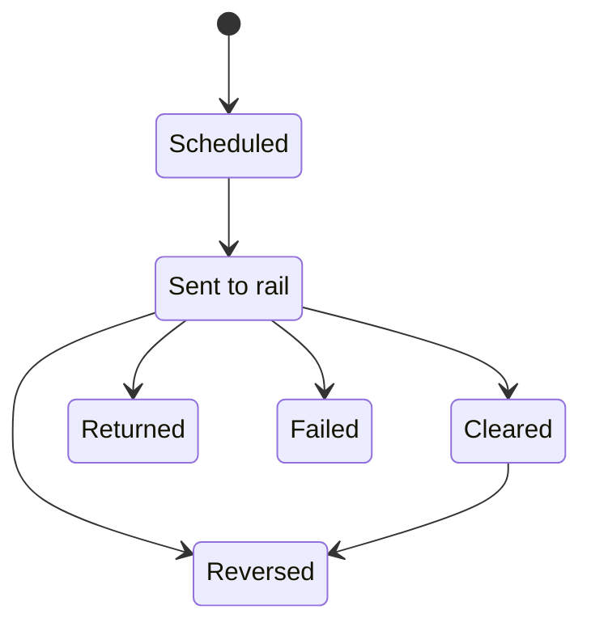

After funds are released, you record each payment's progress through the banking system on the disbursement page, and a reversal claws a payment back with a stated reason.

## The settlement statuses

The **Settlement** badge on the **Controls & settlement** card shows where the payment stands.

| Status | Meaning |
| --- | --- |
| **Scheduled** | Created, not yet released. |
| **Sent to rail** | Released. The cheque is issued or the transfer is sent. |
| **Cleared** | Settled at the receiving bank. |
| **Returned** | Bounced back, for example to a closed or wrong account. |
| **Failed** | The bank or payment system rejected it. |
| **Reversed** | Clawed back after release. |

**Mark disbursed** moves a disbursement from **Scheduled** to **Sent to rail**. From there it ends at **Cleared**, **Returned**, or **Failed**. **Returned**, **Failed**, and **Reversed** are final.

## Update the settlement

<Steps>
  <Step title="Open the disbursement">
    Open the loan from the Disbursement queue, on the **Completed** tab once it is disbursed.
  </Step>
  <Step title="Pick the new status">
    On the **Controls & settlement** card, choose the next status under **Move to**. The list offers only the moves allowed from the current status.
  </Step>
  <Step title="Add a reason and update">
    Add a reason if useful, for example the bank's return code on a returned payment, then click **Update**.
  </Step>
</Steps>

Each move is listed under the badge with its date, time, and reason, and recorded in the audit trail. Updating settlement needs the **Update settlement** permission, which the **Disbursement** role holds.

## Reverse a payment

A reversal claws back a payment that is **Sent to rail** or **Cleared**.

On the **Controls & settlement** card, type the **Reversal reason** and click **Reverse**. The reason is required: a reversal without one is refused, because pulling back released funds is exactly what an auditor will ask about. The status becomes **Reversed** and the reason is kept on the disbursement and in the audit trail.

Reversing needs the **Reverse disbursements** permission, which the **Disbursement** role holds.

## Not yet available

These are planned and not built yet:

- Partial or staged disbursement, with several draws against one loan.
- Batch payment files for ACH and RTGS.
- Automatic matching of bank return files.
- Receipt and payment-advice PDFs.
- Multi-currency disbursements.
