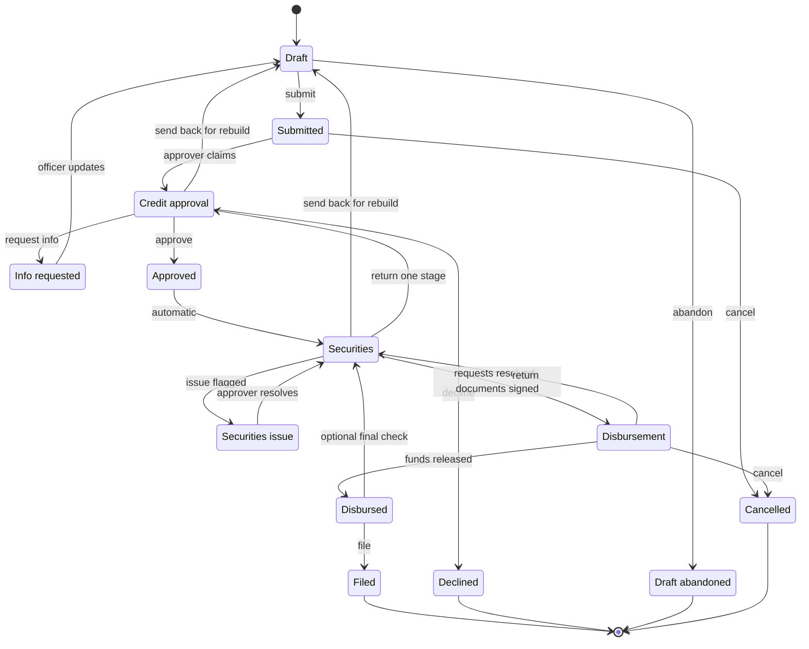

Every loan application moves through one defined workflow. Its stage tells you where it is, who is responsible, and what happens next. Every loan starts as **Draft** and comes to rest in one of four final stages: **Filed**, **Declined**, **Draft abandoned** or **Cancelled**.

## All stages

| Stage | Responsible | What it means |
|---|---|---|
| **Draft** | Credit Officer | Being filled in. Not in any review queue. Only the capturing officer works on it. |
| **Submitted** | Approver | Submitted and waiting in **Credit Approvals**. The risk band is assessed at submission. It moves to **Credit approval** when an approver claims it. |
| **Credit approval** | Approver | The approver reviews the application and decides: approve, decline, or request more information. Who may approve is set by your [approval routes](/omnia/los/workflows/approval-routes): one approver, a committee quorum, or a recorded committee decision. |
| **Info requested** | Credit Officer | The approver needs more information. The officer sends it back to **Draft**, makes the updates and resubmits. The risk band is reassessed. |
| **Approved** | Automatic | Approved. The loan always moves to **Securities** next. |
| **Securities** | Securities | Securities verifies and perfects the collateral. The loan moves to **Disbursement** once every security request is resolved and the documents required at this stage are signed. Unsecured loans have no security requests, so they move on as soon as the required documents are signed. |
| **Securities issue** | Approver | Securities found a problem with the collateral (for example a valuation mismatch or ineligible collateral) and sent it back. The approver resolves it and returns it to Securities. |
| **Disbursement** | Disbursement | Disbursement schedules the payees and releases the funds. Funds cannot be released until the documents required before disbursement are signed. |
| **Disbursed** | Disbursement | Funds released. Disbursement files the loan. If your credit union requires a final securities check after disbursement (off by default), it goes back to Securities first. |
| **Filed** | Final | Complete and locked. No further changes. |
| **Declined** | Final | The approver declined it. The record is kept. |
| **Draft abandoned** | Final | The Credit Officer clicked **Abandon draft**. |
| **Cancelled** | Final | Cancelled from **Submitted** (before anyone claims it) or from **Disbursement**. A loan whose funds have already been released cannot be cancelled. |

<Tip>
  Not sure what to do next on a loan? Check the stage badge. It tells you which department has it.
</Tip>

## How the stages connect

The main path runs from Draft to Filed. Some steps send a file backward: an approver can return it to Draft for a rebuild, Securities can return it to Draft or back to Credit approval, and Disbursement can return it to Securities.

In **Disbursement**, the badge also shows **Awaiting schedule** before payees are scheduled, and **Awaiting execution** once they are.

## Who can make each move

| Move | Permission | Held by default |
|---|---|---|
| Submit a draft | **Submit loans** | Credit Officer, Administrator |
| Abandon a draft | **Edit loans** | Credit Officer, Administrator |
| Claim a submitted loan | **Approve loans** | Adjudicator |
| Cancel a submitted loan | **Edit loans** | Credit Officer, Administrator |
| Approve, decline, request information or return to Draft | **Approve loans** | Adjudicator |
| Send an Info requested loan back to Draft | **Edit loans** | Credit Officer, Administrator |
| Flag or resolve a securities issue | **Approve loans** | Adjudicator |
| Return from Securities to Draft or Credit approval | **Review securities** | Securities |
| Move from Securities to Disbursement | None | Happens automatically once its conditions hold |
| Release funds, cancel, or return to Securities from Disbursement | **Disburse loans** | Disbursement |
| File a disbursed loan | **Disburse loans** | Disbursement |

Three moves have conditions, and each says why when it refuses:

- **Submit**: the member must be **Verified**, required fields complete, the creditor life payment chosen and the cash-secured limit respected. See [Creating an application](/omnia/los/loans/creating-an-application).
- **Securities to Disbursement**: every security request resolved and the documents required at this stage signed. The move happens on its own when the last document is signed.
- **Release funds**: the documents required before disbursement signed.

## Section locking

Once an application leaves **Draft**, every section is read-only: applicant details, income and expenses, collateral, all of it. This protects the record the approver reviewed.

- **Info requested**: the loan goes back to **Draft**, so the officer can update what the approver asked about and resubmit. Back in Draft, the officer can also [change the loan type or product](/omnia/los/loans/changing-loan-type).
- **Securities issue**: the approver resolves the problem and returns it to Securities. Routine document collection happens through security requests while the loan is in **Securities**.

## Status badge colours

| Colour | Stages |
|---|---|
| **Grey** | Draft |
| **Blue** | Submitted, Credit approval, Securities, Disbursement |
| **Amber** | Info requested, Securities issue |
| **Green** | Approved, Disbursed, Filed |
| **Red** | Declined |
| **Purple** | Draft abandoned, Cancelled |

<Note>
  These are the loans list colours. The badge in the application header shows Draft abandoned and Cancelled in grey.
</Note>

## Frequently asked questions

<AccordionGroup>
  <Accordion title="My approved unsecured loan is still in Securities. Why?">
    It is waiting for the documents your credit union requires before disbursement to be signed. When the last one is signed, it moves to **Disbursement** on its own.
  </Accordion>
  <Accordion title="Can a submitted loan be edited?">
    No. Every section locks at submission. The approver can request more information or return it to **Draft**.
  </Accordion>
  <Accordion title="Can a declined loan be reopened?">
    No. **Declined** is final. The member needs a new application.
  </Accordion>
  <Accordion title="What is the difference between Info requested and a return to Draft?">
    **Info requested** carries a list of conditions for the officer. A return to **Draft** sends it back for a full rebuild. Both end with the officer resubmitting.
  </Accordion>
  <Accordion title="Who can cancel a loan?">
    Staff with **Edit loans**, from **Submitted** before anyone claims it. Staff with **Disburse loans**, from **Disbursement**, unless funds have already been released.
  </Accordion>
  <Accordion title="Is a loan ever deleted?">
    No. Every application ends in **Filed**, **Declined**, **Draft abandoned** or **Cancelled** and stays on file.
  </Accordion>
</AccordionGroup>
