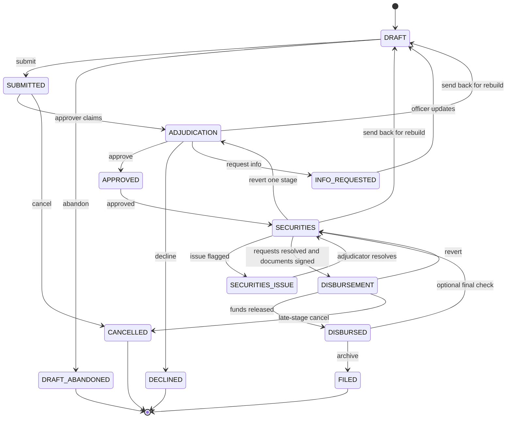

Every loan application moves through one defined workflow. Each status tells you where the application is, who is responsible for it, and what happens next. The initial state is DRAFT, and a loan comes to rest in one of four terminal states: FILED, DECLINED, DRAFT_ABANDONED, or CANCELLED.

## All workflow states

| State | Who is responsible | Description |
|---|---|---|
| **DRAFT** | Credit Officer | The application is being filled in. The officer can save progress and return at any time. A draft does not appear in any review queue, and only the originating Credit Officer works on it. |
| **SUBMITTED** | Adjudicator | The officer submitted the application. The risk assessment is computed during the submit step, and the application is queued in **Credit Approvals** right away. The status changes to ADJUDICATION when an approver claims the file. |
| **ADJUDICATION** | Adjudicator | The approver reviews the application, the risk score, and supporting information, then makes a decision: Approve, Decline, or Request more information. Who may approve is set by your [approval routes](/omnia/los/workflows/approval-routes): one approver, an In-House Committee quorum, or a recorded Credit Committee decision. |
| **INFO_REQUESTED** | Credit Officer | The Adjudicator needs more information before deciding. The application rests here, owned by the officer, until the officer sends it back to DRAFT to make the required updates and resubmit. The risk assessment is recalculated on resubmission. |
| **APPROVED** | System | The application was approved. The loan always moves to **SECURITIES** next. Secured loans (Motor vehicle, Real estate, Cash secured) wait there for collateral review. Unsecured loans get no security requests, so they move on to DISBURSEMENT as soon as the documents your workspace requires before disbursement are signed. |
| **SECURITIES** | Securities | The Securities team verifies and perfects the collateral. The loan moves to DISBURSEMENT when every security request is resolved and the legal documents required at this stage are executed. The documents requested are set per loan rather than fixed by the system. |
| **SECURITIES_ISSUE** | Adjudicator | The Securities team flagged a structural problem with the collateral package (for example, a valuation mismatch or ineligible collateral) and sent it back to the Adjudicator. The Adjudicator resolves the issue and returns the file to the Securities team. |
| **DISBURSEMENT** | Disbursement | All collateral has been cleared. Disbursement schedules the payees and executes the release of funds. Funds cannot be released until the legal documents required before disbursement are executed. |
| **DISBURSED** | Disbursement | Funds have been released. The Disbursement team files the loan to complete it. If the `securitiesFinalCheckRequired` workflow override is set (it defaults to off), the loan returns to Securities for a final post-disbursement check first. |
| **FILED** | Terminal | The loan record is locked. The audit trail is complete. No further edits or transitions are possible. |
| **DECLINED** | Terminal | The Adjudicator declined the application. The record is sealed and preserved in the audit trail. |
| **DRAFT_ABANDONED** | Terminal | The Credit Officer chose not to proceed with the draft and selected Abandon Draft. |
| **CANCELLED** | Terminal | The application was cancelled. Cancellation is possible from SUBMITTED (before adjudication begins) and from DISBURSEMENT (the late-stage escape hatch). A disbursement that has already been executed blocks cancellation. |

<Tip>
  If you are not sure what to do next on a loan, check the status badge. It tells you which department holds the ball.
</Tip>

---

## How states connect

The diagram below shows the primary path a loan takes from creation to filing, plus the send-back, revert, and cancel branches. Several states can send a file backward: an Adjudicator can return it to DRAFT for a full rebuild, Securities can return it to DRAFT or back one stage to ADJUDICATION, and Disbursement can revert it to SECURITIES.

While a loan sits in DISBURSEMENT, the status badge shows one of two sub-state labels: **AWAITING SCHEDULE** before a disbursement instruction exists, and **AWAITING EXECUTION** once the instruction is scheduled.

---

## Who can make each move

Each transition needs a capability, on top of the global `workflows.transition` and `loans.transition` gates.

| Move | Capability | Held by default |
|---|---|---|
| DRAFT to SUBMITTED | `loans.submit` | Credit Officer, Administrator |
| DRAFT to DRAFT_ABANDONED | `loans.edit` | Credit Officer, Administrator |
| SUBMITTED to ADJUDICATION (claim) | `loans.adjudicate` | Adjudicator |
| SUBMITTED to CANCELLED | `loans.edit` | Credit Officer, Administrator |
| ADJUDICATION to APPROVED, DECLINED, INFO_REQUESTED or DRAFT | `loans.adjudicate` | Adjudicator |
| INFO_REQUESTED to DRAFT | `loans.edit` | Credit Officer, Administrator |
| APPROVED to SECURITIES | `loans.adjudicate` | Adjudicator (runs as part of approval) |
| SECURITIES to SECURITIES_ISSUE, SECURITIES_ISSUE to SECURITIES | `loans.adjudicate` | Adjudicator |
| SECURITIES to DRAFT or ADJUDICATION | `securities.review` | Securities |
| SECURITIES to DISBURSEMENT | `loans.transition` | Runs automatically once its conditions hold |
| DISBURSEMENT to DISBURSED, CANCELLED or SECURITIES | `loans.disburse` | Disbursement |
| DISBURSED to FILED | `loans.disburse` | Disbursement |
| DISBURSED to SECURITIES | `loans.adjudicate` | Only when `securitiesFinalCheckRequired` is on |

Three transitions carry conditions that must hold, and each one says why when it refuses:

- **DRAFT to SUBMITTED**: the member's KYC must be exactly VERIFIED. Submission also checks your workspace's required fields, the creditor life payment choice and the cash-secured advance limit first, and tells the officer what is missing. See [Creating an application](/omnia/los/loans/creating-an-application).
- **SECURITIES to DISBURSEMENT**: every security request resolved, and the legal documents required at the Securities stage executed. The move is retried automatically when the last of those documents is executed.
- **DISBURSEMENT to DISBURSED**: the legal documents required before disbursement executed.

---

## Section locking

Once a loan application moves past DRAFT status, all form sections become **read-only**. You can no longer edit the applicant information, employment details, statement of affairs, or collateral data while the loan is under review.

The only exceptions are states where the platform explicitly unlocks specific sections for a targeted action.

- **INFO_REQUESTED:** the application returns to DRAFT, so the officer can update the sections the approver identified as needing clarification, then resubmit. Back in DRAFT, the officer can also [change the loan type or product](/omnia/los/loans/changing-loan-type).
- **SECURITIES_ISSUE:** this state is owned by the Adjudicator, who resolves the flagged structural problem and returns the file to Securities. Routine document collection happens through the security-request loop while the loan is in SECURITIES, not in SECURITIES_ISSUE.

All other sections stay locked throughout the loan's lifetime after submission. This protects the integrity of the record the Adjudicator reviewed and ensures the audit trail reflects what was actually decided.

---

## Status badge colours

The platform displays a coloured status badge on every loan record in the loans list view. The colours give a quick visual cue.

| Colour | States |
|---|---|
| **Grey** | DRAFT |
| **Blue** | SUBMITTED, ADJUDICATION, SECURITIES, DISBURSEMENT |
| **Amber** | INFO_REQUESTED, SECURITIES_ISSUE |
| **Green** | APPROVED, DISBURSED, FILED |
| **Red** | DECLINED |
| **Purple** | DRAFT_ABANDONED, CANCELLED |

<Note>
  This table describes the list view. The badge on the application header uses a slightly different palette: it groups DRAFT_ABANDONED and CANCELLED with DRAFT and shows all three as grey rather than purple.
</Note>

<Note>
  Loans are never deleted. Even DECLINED or CANCELLED applications stay in the system for the audit record. Staff with the appropriate read permissions can always locate and review the full history of any application.
</Note>

## Frequently asked questions

<AccordionGroup>
  <Accordion title="My approved unsecured loan is still in SECURITIES. Why?">
    It is waiting for the legal documents your workspace requires before disbursement to be signed. When the last one is executed, it moves to DISBURSEMENT on its own.
  </Accordion>
  <Accordion title="Can a submitted loan be edited?">
    No. Every section locks at submission. To change it, the approver requests more information or returns it to DRAFT.
  </Accordion>
  <Accordion title="Can a declined loan be reopened?">
    No. DECLINED is terminal. The member needs a new application.
  </Accordion>
  <Accordion title="What is the difference between INFO_REQUESTED and returned to DRAFT?">
    INFO_REQUESTED carries a list of conditions for the officer and keeps the same file. A return to DRAFT sends it back for a full rebuild. Both end with the officer resubmitting.
  </Accordion>
  <Accordion title="Who can cancel a loan?">
    A holder of `loans.edit` from SUBMITTED, before anyone claims it. A holder of `loans.disburse` from DISBURSEMENT, unless a disbursement has already been executed.
  </Accordion>
  <Accordion title="Is a loan ever deleted?">
    No. Every application ends in FILED, DECLINED, DRAFT_ABANDONED or CANCELLED and stays on file.
  </Accordion>
</AccordionGroup>
