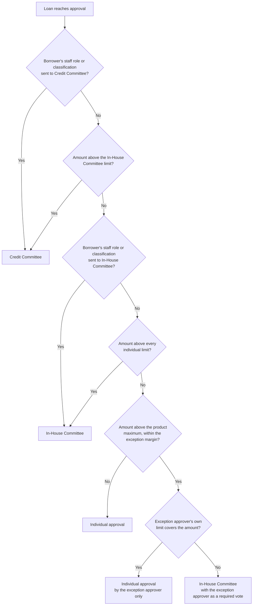

Every loan is approved under your credit union's approval policy, which decides who may approve it, alone or as a committee. The policy has two parts: **approval authority** (how much each role may approve on its own) and **routing rules** (when a loan needs a committee instead). Both are set up from your board-approved delegation of authority. The LOS enforces them at the moment of approval, and checks them earlier at claim so nobody picks up a loan they cannot finish.

<Note>
  Both parts are optional. Without approval authority set up, anyone with the **Approve loans** permission can approve any amount. Without routing rules, every loan is an individual approval.
</Note>

## Approval authority

Approval authority gives each role a limit for each **type of security**. There are three:

| Type of security | Covers |
|---|---|
| Unsecured | Unsecured products |
| Motor vehicle and real estate | Motor vehicle and real estate products |
| Cash secured | Cash-secured products |

Each of your loan products belongs to one type. For each type, a role either has a limit (an amount, or deliberately unlimited) or has **no individual approval**, meaning it may not approve alone.

The LOS fails closed:

- A role that has no entry cannot approve.
- A type left blank for a role means no authority for that type, never unlimited.
- A product whose type cannot be resolved cannot be approved by anyone until the setup is fixed.

<Note>
  Illustrative example only: an Adjudicator might approve unsecured loans up to $1,000,000 and secured loans up to $3,000,000, with larger loans left to the Credit Manager. Your credit union sets its own figures.
</Note>

Approval authority is not the personal disbursement ceiling shown on **Users & Roles**. That ceiling limits a single disbursement.

## Who can claim a loan for approval

While a loan is **Submitted** or in **Approval**, holding it means being its approver. On an individual-approval loan, the LOS checks authority before you take it:

- **Claim** is refused when you cannot approve this loan on your own. The message names who can and suggests assigning it to one of them, or sending it back.
- **Assign to** lists only people who can approve this loan on their own.

Loans on a committee route skip this check. The committee's own rules apply instead.

<Frame caption="The approval route card names the route, why the loan is on it, and what is still needed before it can be approved.">
  
</Frame>

## The three approval routes

The **Approval route** card on the Credit Approvals page and on the loan page shows the route as **Individual approval**, **In-House Committee** or **Credit Committee**, with the reason.

### Individual approval

One approver decides, within their own limit. If you lack authority, the approval is refused and the message names the roles that can approve it.

### In-House Committee

Several approvers each record an approval inside the LOS. Each one is a **vote**. The loan is approved on the vote that completes the **quorum**. Your credit union's routing rules set:

- **Members**: the roles that may vote.
- **Quorum**: how many different people must approve.
- **Required roles**: roles that must be among the votes.
- **Limits**: the committee's own limit for each type of security. Above it, the loan goes to the Credit Committee.

The card shows "N of M committee approvals recorded" and which required role must still be one of them. When you approve as a member, the decision form says your approval is recorded as a committee vote. Each person votes once.

<Note>
  Illustrative example only: a committee of Credit Manager, Adjudicator and Branch Manager with a quorum of two, the Credit Manager required. A Credit Manager plus any one other member approves the loan. Two Adjudicators do not.
</Note>

<Frame caption="An In-House Committee loan with one of two approvals recorded. The note says which role must still be one of them.">
  
</Frame>

Votes count for one pass through approval. A decline, a request for information, or a return to draft clears the votes, so the next pass starts with a fresh quorum.

### Credit Committee

The Credit Committee meets outside the LOS, and one designated person **records** its decision. Your routing rules name who records it, and can name a substitute for when the borrower is the usual recorder, so nobody records the decision on their own loan.

To record it, choose **Approve** and fill the **Credit Committee decision** fields:

- **Meeting date**: required, not in the future.
- **Minute number (optional)**: up to 80 characters.
- **Proof of approval (PDF or image, up to 10 MB)**: required. The signed minute or approval memo.

The loan is approved when you submit. The card then reads "Approved at the meeting of DATE, minute N, recorded by" the recorder's role, with a link to the proof of approval.

## How the route is chosen

The first rule that applies wins. "Borrower" means the member the loan is for; staff borrowers and member classifications are explained on [Staff and confidential loans](/omnia/los/loans/confidential-and-staff-loans).

The card states the reason in plain words, for example "The amount is above every individual approver's limit for this security type."

## Product-limit exceptions

A product has a maximum amount, and normally the officer cannot save an amount above it. Your credit union can allow a margin above the maximum as an **exception**, approved by one named role.

- **At capture**, an amount inside the margin shows an amber **Exception: above the product maximum** panel stating the maximum, how far an exception can go, and who can approve it. The officer must write an **Exception reason** (at least 20 characters) or the amount does not save. An amount beyond the margin is refused.
- **On an individual route**, only the exception approver may approve, and only within their own limit. When their limit does not cover the amount, the loan goes to the In-House Committee.
- **On the In-House Committee**, the exception approver becomes a required vote.
- **On the Credit Committee**, nothing changes; the committee sits above the exception.

The exception approver must be a member of the In-House Committee. The reason is kept in the audit trail and shown on the approval route card.

<Note>
  Illustrative example only: with a $5,000,000 product maximum and a 5% margin, $5,200,000 can be approved as an exception with a reason, and $5,300,000 is refused.
</Note>

## Waivers

A **waiver** is a recorded exception to policy on one loan, like a missing payslip or a savings requirement not met. Waivers are decided before the loan.

**Request a waiver** sits on the approval route card while the loan is in **Draft**, **Submitted**, **Approval** or **Info requested**. Anyone who creates or approves loans can request one. Give:

- **What is to be waived**: 3 to 200 characters.
- **Justification**: at least 20 characters.
- An optional supporting file (PDF, PNG or JPEG).

Your routing rules name the roles that approve waivers. Every one of them must approve. A single rejection rejects the waiver, and a rejection needs a comment of at least 10 characters. The person who requested a waiver cannot decide it, and only the requester can withdraw a pending one.

While any waiver is **pending**, the loan cannot be approved. Your credit union can also require an approved waiver for certain borrower classifications or staff roles; those loans cannot be approved until one is in place.

## Maker-checker rules on approval

Your credit union can switch on two separation-of-duty rules. Each is off until your credit union adopts it.

| Rule | What you see |
|---|---|
| The person who captured the application may not approve it | "Approval denied: you captured this application, so another approver must decide it." |
| The person who manually overrode the rate may not approve it | "Approval denied: you changed the rate on this application, so another approver must decide it." |

"Captured" means the person who created the application. The rate rule applies only while an override is in force; approving a loan whose rate someone else changed is fine.

On committee routes these people are always excluded: a capturer or rate overrider cannot cast an In-House Committee vote, and a capturer cannot record the Credit Committee's decision.

Disbursement has its own maker-checker rule: only the Credit Manager approves disbursements. See [Disbursement controls](/omnia/los/disbursement/controls).

## What is checked at the moment of approval

Whatever path an approval takes, the approve step checks, in order:

1. The maker-checker rules your credit union has switched on.
2. The amount against the product maximum and any exception margin, with an exception reason recorded.
3. Pending or required waivers, and any staff borrowing limit your credit union sets.
4. The route's evidence: a complete In-House quorum, or a recorded Credit Committee decision with proof.
5. On an individual route, that the approver is the exception approver, when the loan is an exception.
6. The risk band against the product's ceiling, with the override rules described on [Credit approvals](/omnia/los/workflows/adjudication).
7. On an individual route, the approver's own limit.

A refusal leaves the loan in **Approval** and says why.

## Frequently asked questions

<AccordionGroup>
  <Accordion title="Why can I not claim this loan?">
    You cannot approve it on your own for this type of security and amount. The message names the roles that can. Ask a supervisor to assign it to one of them.
  </Accordion>
  <Accordion title="I approved but the loan is still in Approval. Why?">
    It is on the In-House Committee route and your approval was recorded as a vote. The loan is approved when the quorum, including any required role, is complete. The route card shows how many approvals are recorded and who is still needed.
  </Accordion>
  <Accordion title="Who records a Credit Committee decision?">
    The person your routing rules name, shown on the route card as "Recorded by". If the borrower is that person, the substitute records it.
  </Accordion>
  <Accordion title="Can the officer who captured the loan approve it?">
    Not when your credit union has switched on the capturer rule, and never as an In-House Committee vote or as the Credit Committee recorder.
  </Accordion>
  <Accordion title="The amount is a little over the product maximum. Can it be approved?">
    Only if your credit union allows product-limit exceptions and the amount is inside the margin. The officer records a reason at capture, and the named exception approver must approve.
  </Accordion>
  <Accordion title="Does a waiver approve the loan?">
    No. A waiver clears one policy exception. The loan still needs its normal approval on its route afterwards.
  </Accordion>
  <Accordion title="How do we change our limits?">
    Approval authority and routing rules are set up from your approved delegation of authority, outside the app. Send the revised schedule to your LOS support team.
  </Accordion>
</AccordionGroup>
