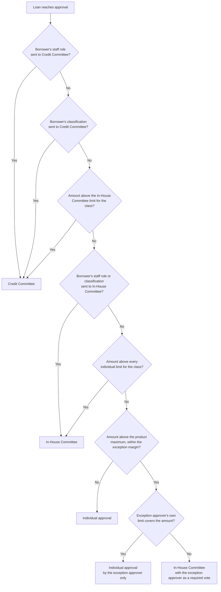

Every loan is approved under your workspace's approval policy, which decides who may approve it, alone or as a committee. The policy is two documents held as workspace configuration: an **approval schedule** (how much each role may approve on its own) and an **approval routing policy** (when a loan needs a committee instead). CompuZign loads both from your board-approved delegation of authority. The platform enforces them at the moment of approval, and checks them earlier at claim so nobody picks up a loan they cannot finish.

<Note>
  Without an approval schedule, any holder of `loans.adjudicate` approves any amount, as before. Without a routing policy, every loan is an individual approval. Both are optional and set per workspace.
</Note>

## Delegated authority: the approval schedule

The schedule gives each role a limit for each **security class**. There are three classes:

| Security class | Covers |
|---|---|
| Unsecured | Unsecured products |
| Motor vehicle and real estate | Motor vehicle and real estate products |
| Cash secured | Cash-secured products |

Each of your loan products is mapped to one class. A role's entry is one of:

- **A limit per class.** An amount, or "unlimited" stated deliberately.
- **No individual approval.** The role is in the schedule but may not approve alone.

The platform fails closed. A role the schedule does not mention cannot approve. A class the schedule leaves blank for a role means no authority for that class, never unlimited. A product mapped to a class that the schedule cannot resolve cannot be approved by anyone until the schedule is fixed. A product the schedule does not mention at all is outside the schedule and keeps plain `loans.adjudicate` approval.

<Note>
  Fictional example schedule:

  | Role | Unsecured | Motor vehicle and real estate | Cash secured |
  |---|---|---|---|
  | Adjudicator | JMD 1,000,000 | JMD 3,000,000 | No authority |
  | Branch Manager | No authority | No authority | JMD 2,000,000 |
  | Credit Manager | JMD 4,000,000 | JMD 12,000,000 | Unlimited |
</Note>

Approval authority is not the per-officer disbursement ceiling shown on **Users & Roles**. That ceiling limits a single disbursement. Approval authority lives only in the schedule.

## Who can claim a loan for approval

At SUBMITTED and ADJUDICATION, holding a loan means being its approver. On an individual-approval loan governed by the schedule, the platform therefore checks authority before you take it:

- **Claim** is refused when your role cannot approve this loan on its own. The message names who can: "Adjudicator cannot approve Personal Loan (unsecured) loans at this amount under the approval schedule. It can be approved by: Credit Manager. Assign it to one of them, or send it back."
- **Assign to** lists only people whose role can approve this loan on its own.

Loans on a committee route skip this check. Their committee membership rules apply instead.

<Frame caption="The approval route card names the route, why the loan is on it, and what is still needed before it can be approved.">
  
</Frame>

## The three approval routes

The **Approval route** card on the Credit Approvals page and on the loan page shows the route as **Individual approval**, **In-House Committee** or **Credit Committee**, with the reason.

### Individual approval

One approver decides, within their own limit. If the approver's role lacks authority, the approval is refused with "Approval denied: ROLE lacks authority for PRODUCT-CODE at the requested amount." followed by the roles that can approve it.

### In-House Committee

Several approvers each record an approval. Each one is a **vote**. The loan is approved on the vote that completes the **quorum**. The routing policy sets:

- **Members**: the roles that may vote.
- **Quorum**: how many distinct people must approve.
- **Required roles**: roles that must be among the votes.
- **Limits**: the committee's own limit per security class. Above it, the loan goes to the Credit Committee.

The card shows "N of M committee approvals recorded" and which required role must still be one of them. When you approve as a member, the decision form says "Approving records your approval as a committee member. The loan is approved when the committee quorum is complete." A person votes once; a second approval from the same person is refused.

<Note>
  Fictional example: members Credit Manager, Adjudicator and Branch Manager; quorum 2; Credit Manager required. A Credit Manager plus any one other member approves the loan. Two Adjudicators do not.
</Note>

<Frame caption="An In-House Committee loan with one of two approvals recorded. The note says which role must still be one of them.">
  
</Frame>

Votes belong to one pass through ADJUDICATION. A decline, a request for information, a return to draft or a revert voids the votes, so the next pass starts with a fresh quorum.

### Credit Committee

The Credit Committee meets outside the platform. One designated role **records** its decision. The routing policy names the recorder roles, and can name a substitute recorder when the borrower holds the recorder role, so nobody records the decision on their own loan.

To record it, choose **Approve** and fill the **Credit Committee decision** fields:

- **Meeting date**: required, not in the future.
- **Minute number (optional)**: up to 80 characters.
- **Proof of approval (PDF or image, up to 10 MB)**: required. The signed minute or approval memo.

The loan is approved when you submit. The card then reads "Approved at the meeting of DATE, minute N, recorded by the ROLE" with a link to the proof of approval.

## How the route is chosen

The first rule that applies wins. "Borrower" means the member the loan is for; staff roles and classifications are explained on [Staff and confidential loans](/omnia/los/loans/confidential-and-staff-loans).

The card states the reason in plain words, for example "The amount is above every individual approver's limit for this security type."

## Product-limit exceptions

A product has a maximum amount. Normally the officer cannot save an amount above it. Your routing policy can allow a margin above the maximum as an **exception**: a percentage of the maximum and the one role that must approve it.

- **At capture**, an amount inside the margin shows an amber **Exception: above the product maximum** panel stating the maximum, how far an exception can go, and who can approve it. The officer must write an **Exception reason**, at least 20 characters by default and up to 1,000. Without it the amount does not save. An amount beyond the margin is refused: "Above the maximum for CODE. The maximum is X; up to Y is possible only as an exception."
- **On an individual route**, only the exception approver may approve, and only within their own limit. Anyone else sees "This amount is above the product maximum, so only the ROLE can approve it as an exception." When the exception approver's limit does not cover the amount, the loan goes to the In-House Committee.
- **On the In-House Committee**, the exception approver becomes a required vote.
- **On the Credit Committee**, nothing changes; the committee sits above the exception.
- **Beyond the margin at approval**, the loan cannot be approved until the amount is reduced.

The exception approver must be a member of the In-House Committee. The reason is recorded with `loan_application.product_limit_exception.recorded` and shown on the approval route card.

<Note>
  Fictional example: a product maximum of JMD 5,000,000 with a 5% exception margin. JMD 5,200,000 is an exception the named approver can sign off with a reason. JMD 5,300,000 is refused.
</Note>

## Waivers

A **waiver** is a recorded exception to policy on one loan: a missing payslip, a savings requirement, a staff car loan over its limit. Waivers are decided before the loan.

**Request a waiver** sits on the approval route card while the loan is in DRAFT, SUBMITTED, ADJUDICATION or INFO_REQUESTED. Anyone holding `loans.create` or `loans.adjudicate` can request one. Give:

- **What is to be waived**: 3 to 200 characters.
- **Justification**: at least 20 characters.
- An optional supporting file (PDF, PNG or JPEG).

The routing policy names the **waiver approver roles**. Every one of those roles must approve the waiver. A single rejection rejects it, and a rejection needs a comment of at least 10 characters. The person who requested a waiver cannot decide it, and only the requester can withdraw a pending one. Deciding a waiver also needs `loans.adjudicate`.

While any waiver is **pending**, the loan cannot be approved: "Approval blocked: a waiver on this application is still awaiting approval. Waivers are decided before the loan." The routing policy can also require an approved waiver for listed borrower classifications or staff roles. Those loans cannot be approved until a waiver is approved: "Approval blocked: this borrower's loans need an approved waiver before the loan can be approved."

Waiver events: `loan_application.waiver.requested`, `loan_application.waiver.decided` and `loan_application.waiver.withdrawn`.

## Maker-checker rules on approval

Two separation-of-duty rules can be switched on for your workspace. Each is a workspace setting, off unless your credit union adopts it.

| Rule | Setting | Refusal |
|---|---|---|
| The person who captured the application may not approve it | `approverMustNotBeCapturer` | "Approval denied: you captured this application, so another approver must decide it." |
| The person who manually overrode the rate may not approve it | `approverMustNotBeRateOverrider` | "Approval denied: you changed the rate on this application, so another approver must decide it." |

"Captured" means the user who created the application. The rate rule applies only while an override is in force; approving a loan whose rate someone else changed is fine. Both rules run before anything else at approval, and a refusal records `adjudication.authority.denied` with the reason.

On committee routes the same people are excluded regardless of those settings: a capturer or rate overrider cannot cast an In-House Committee vote, and a capturer cannot record the Credit Committee's decision.

Separately, disbursement keeps its own maker-checker rule: `disbursements.approve` belongs only to the Credit Manager. See [Disbursement controls](/omnia/los/disbursement/controls).

## What is checked at the moment of approval

Whatever path an approval takes, the approve step re-checks, in order:

1. Maker-checker settings.
2. The amount against the product maximum and any exception margin, with an exception reason recorded.
3. Pending or required waivers, and the staff motor-vehicle limit.
4. The route's evidence: a complete In-House quorum, or a recorded Credit Committee decision with proof.
5. On an individual route, that the approver is the exception approver, when the loan is an exception.
6. The risk band against the product's ceiling, with the override rules described on [Credit approvals](/omnia/los/workflows/adjudication).
7. On an individual route, the approver's own limit in the approval schedule.

A refusal leaves the loan in ADJUDICATION and says why.

## Frequently asked questions

<AccordionGroup>
  <Accordion title="Why can I not claim this loan?">
    Your role cannot approve it on its own under the approval schedule, for this security class and amount. The message names the roles that can. Ask a supervisor to assign it to one of them.
  </Accordion>
  <Accordion title="I approved but the loan is still in ADJUDICATION. Why?">
    It is on the In-House Committee route and your approval was recorded as a vote. The loan is approved when the quorum, including any required role, is complete. The route card shows how many approvals are recorded and who is still needed.
  </Accordion>
  <Accordion title="Who records a Credit Committee decision?">
    The recorder role your routing policy names, shown on the route card as "Recorded by". If the borrower holds that role, a substitute recorder records it.
  </Accordion>
  <Accordion title="Can the officer who captured the loan approve it?">
    Not when your workspace has switched on the capturer rule, and never as an In-House Committee vote or as the Credit Committee recorder.
  </Accordion>
  <Accordion title="The amount is a little over the product maximum. Can it be approved?">
    Only if your routing policy allows product-limit exceptions and the amount is inside the margin. The officer records a reason at capture, and the named exception approver must approve.
  </Accordion>
  <Accordion title="Does a waiver approve the loan?">
    No. A waiver clears one policy exception. The loan still needs its normal approval on its route afterwards.
  </Accordion>
  <Accordion title="How do we change our limits?">
    The schedule and routing policy are workspace configuration loaded by CompuZign from your approved delegation of authority. Send the revised schedule to CompuZign support; there is no in-app editor.
  </Accordion>
</AccordionGroup>
